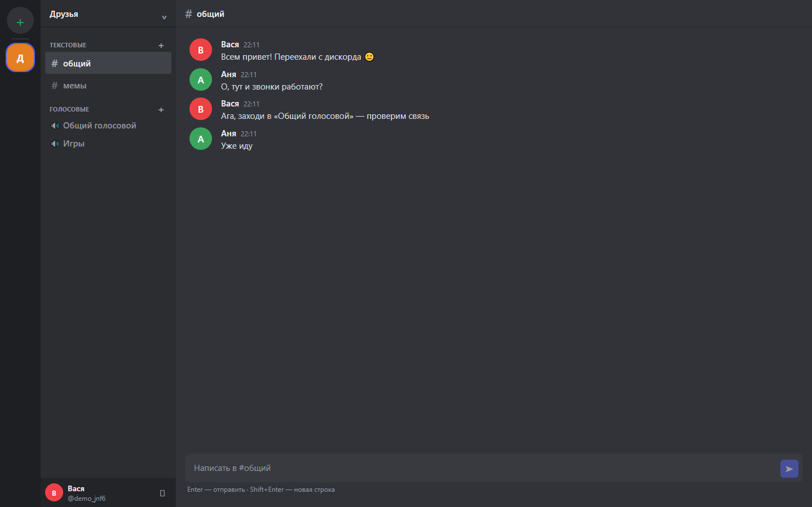
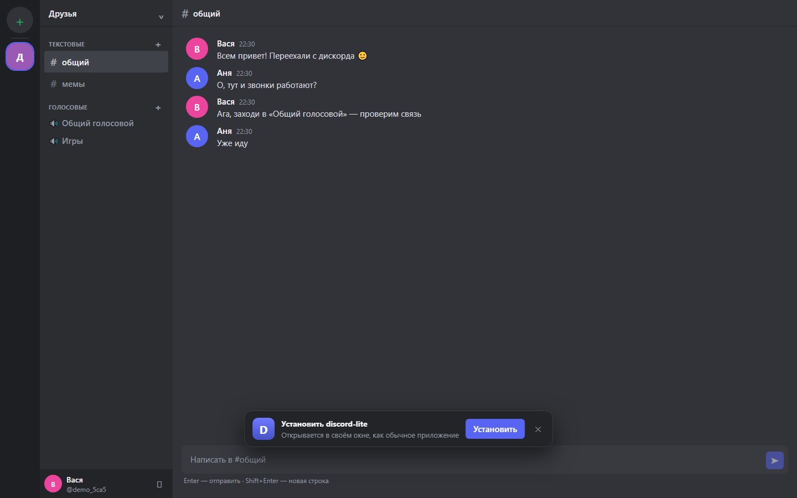
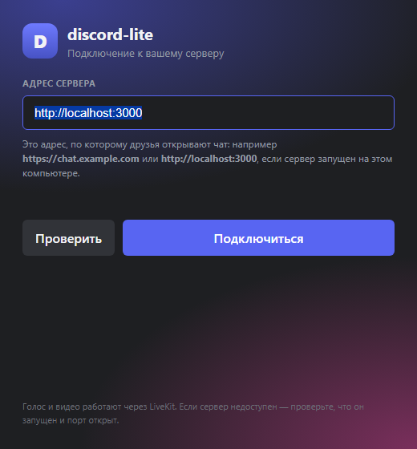
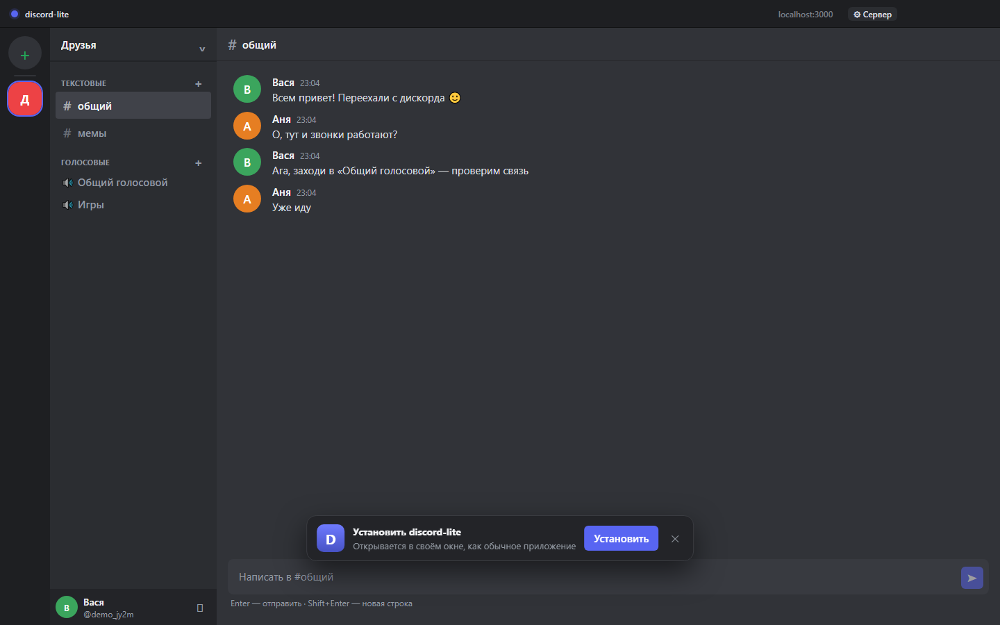

# discord-lite — своя копия Discord для друзей

Серверы, текстовые и голосовые каналы, живой чат и звонки на **LiveKit**. Интерфейс в духе Discord: рейл серверов, список каналов, чат, панель голоса с микрофоном, камерой и демонстрацией экрана. Ставится на рабочий стол как приложение (PWA).



- **Фронтенд:** Next.js 15 (React 19), собственный CSS в стиле Discord
- **Бэкенд:** Express 4 (REST `/api/*`) + Socket.IO (чат и присутствие)
- **БД:** PostgreSQL + Prisma (для локального просмотра — встроенный SQLite)
- **Голос/видео:** LiveKit (SFU — так же работает голос в самом Discord)
- **PWA:** манифест, service worker, кэш оболочки, установка на рабочий стол
- **HTTPS:** Caddy с автоматическим сертификатом Let's Encrypt

---

## Что уже работает

| Функция | Статус |
|---|---|
| Регистрация и вход (bcrypt + cookie-сессия) | ✅ |
| Серверы, текстовые и голосовые каналы | ✅ |
| История сообщений в БД, живая доставка | ✅ |
| Голосовые каналы: вход/выход, список участников, мьют | ✅ |
| Камера и демонстрация экрана (через LiveKit) | ✅ |
| Мобильная вёрстка | ✅ |
| Установка как приложение (PWA), офлайн-оболочка | ✅ |
| Роли и права, личные сообщения, вложения, инвайты | ⏳ дальше |

---

## Быстрый старт на Windows (без Docker и Postgres)

Нужен только Node.js 20+. База — встроенная в Node SQLite, голос — локальный LiveKit.

```powershell
npm install
npm run build

# 1) отдельное окно: локальный сервер голоса
npm run livekit

# 2) в этом окне: приложение
$env:SQLITE_URL="file:./data/dev.db"
npm start
```

Открывай http://localhost:3000, регистрируйся, создавай сервер и заходи в голосовой канал.
Оба окна должны оставаться открытыми: `npm run livekit` — это сервер, через который идёт звук.

Если LiveKit ещё не скачан (нет `tools/livekit/livekit-server.exe`):

1. Скачай `livekit_*_windows_amd64.zip` со https://github.com/livekit/livekit/releases
2. Распакуй `livekit-server.exe` в `tools/livekit/`.

Проверки одной командой:

```powershell
npm run livekit:check     # рукопожатие с LiveKit (как это делает браузер)
npm run voice:check       # реальный вход в голосовой канал в headless Chrome
npm run pwa:check         # манифест, service worker, офлайн-оболочка
npm run smoke -- http://localhost:3000   # 21 проверка API и WebSocket
```

---

## Полный запуск с PostgreSQL

```bash
cp .env.example .env      # заполните JWT_SECRET и пароль БД
docker compose up -d db   # PostgreSQL на localhost:5432
npm install
npm run db:push           # создать таблицы
npm run db:seed           # демо: alice / bob, пароль password123
npm run build
npm start
```

Или одной командой через compose (приложение + БД + LiveKit + Caddy):

```bash
docker compose up -d --build
```

---

## Голос: три варианта

### 1. Локальный LiveKit на Windows (то, что нужно для разработки)

`infra/livekit.local.yaml` уже содержит порт 7880, диапазон UDP 50000–50100 и ключи
`devkey` / `secret` — ровно те, что в `.env`.

```powershell
npm run livekit
```

Проверить, что сервер отвечает:

```powershell
npm run livekit:check
# ✓ WebSocket открыт
# ✓ ответ сервера на /rtc — сигнализация работает
```

### 2. LiveKit Cloud — проще всего для друзей без своего сервера

1. https://cloud.livekit.io → создать проект.
2. Скопировать `wss://…livekit.cloud`, API Key и Secret в `.env`.
3. Перезапустить приложение.

Звонки идут через серверы LiveKit, а не через твой ПК. Бесплатного тарифа
хватает на компанию друзей.

### 3. Свой LiveKit на VPS (docker compose)

`docker-compose.yml` содержит LiveKit. Открой порты `7880/tcp`, `7881/tcp`,
`50000-50100/udp` и проксируй WebSocket на домен:

```caddyfile
livekit.вашдомен {
    reverse_proxy livekit:7880
}
```

```env
LIVEKIT_URL=wss://livekit.вашдомен
```

> Для боевого сервера возьми ключи длиннее 32 символов: LiveKit предупреждает,
> что короткие секреты небезопасны. Локальные `devkey`/`secret` — только для разработки.

> Микрофон браузер отдаёт только в защищённом контексте: `localhost` и `https://`
> работают, `http://192.168.x.x` — нет.

---

## Ошибка «could not establish signal connection: Failed to fetch»

Это значит, что браузер не смог открыть WebSocket до LiveKit. Причины по частоте:

| Причина | Как проверить | Решение |
|---|---|---|
| LiveKit не запущен | `Get-NetTCPConnection -LocalPort 7880` пусто | `npm run livekit` |
| Порт занят другим процессом | `npm run livekit` пишет `address already in use` | закрыть старый LiveKit или сменить `port` в `infra/livekit.local.yaml` |
| `LIVEKIT_URL` не совпадает | в `.env` должно быть `ws://localhost:7880` | поправить `.env` и перезапустить `npm start` |
| Ключи не совпадают | `npm run livekit:check` → ошибка токена | ключи в `.env` и в `infra/livekit.local.yaml` должны быть одинаковыми |
| Страница открыта по HTTPS, а LiveKit по `ws://` | в адресной строке `https://` | для HTTPS нужен `wss://` (домен + reverse proxy) |
| Открываешь с телефона по IP | `http://192.168…` | нужен HTTPS-туннель (`cloudflared`) или домен |

Быстрая диагностика: `npm run livekit:check` и `npm run voice:check`.

---

## Приложение на рабочем столе (PWA)



Что добавлено:

- `src/app/manifest.ts` — манифест (`/manifest.webmanifest`): имя, иконки 192/512/maskable, `display: standalone`, цвета.
- `public/sw.js` — service worker: кэширует оболочку и статику, не трогает `/api` и `/socket.io`.
- `src/components/PwaInstall.tsx` — регистрация SW и баннер «Установить приложение».
- Иконки — `public/icons/*` и `src/app/icon.png`, `src/app/apple-icon.png` (генерируются `scripts/make-icons.py`).

Как установить:

- **Chrome / Edge (ПК):** иконка «Установить» в адресной строке или меню ⋮ → «Установить discord-lite». Также появится баннер внизу страницы.
- **Android:** меню ⋮ → «Установить приложение» / «Добавить на главный экран».
- **iPhone / iPad:** «Поделиться» → «На экран „Домой“».

После установки приложение открывается в своём окне без адресной строки. Оболочка
кешируется, поэтому при пропаже сети откроется последний интерфейс (чат и звонки,
разумеется, требуют интернета).

Проверка: `npm run pwa:check` — 20 пунктов, включая офлайн-открытие.

---

## Деплой в интернет (Render + LiveKit Cloud)

Подробная инструкция: **[DEPLOY.md](DEPLOY.md)**. Коротко:

| Часть | Где | Тариф |
|---|---|---|
| Сайт, API, Socket.IO | Render, Web Service | Free (засыпает через 15 мин) |
| База данных | Neon Postgres | Free (0.5 ГБ, без срока) |
| Голос/видео | LiveKit Cloud | Build: 5 000 минут WebRTC в месяц |

Почему не Vercel: он не держит постоянные WebSocket-соединения, а чат работает на Socket.IO.

Файлы для деплоя: `render.yaml` (Blueprint), `.env.production.example` (шпаргалка по переменным).
После деплоя проверка одной командой:

```powershell
npm run check:remote -- https://discord-lite-xxxx.onrender.com
```
## Десктопное приложение для Windows (Electron)



Внутри окна — та же тёмная шапка с названием, адресом сервера и кнопкой смены сервера:



Настоящее окно Windows, а не вкладка браузера: своя иконка в панели задач и на рабочем
столе, тёмная шапка, микрофон/камера/демонстрация экрана работают без вопросов, меню и
переключение серверов — внутри приложения.

| Что внутри | Где |
|---|---|
| Главный процесс, окно, меню, разрешения | `desktop/main.js` |
| Мост в окно (безопасный, без Node) | `desktop/preload.js` |
| Настройка адреса сервера при первом запуске | `desktop/setup.html`, `desktop/setup.js` |
| Проверка и сохранение адреса | `desktop/config.js` + IPC в `main.js` |
| Иконка приложения | `build/icon.ico` (генерируется `npm run icons`) |

### Как собрать .exe

```powershell
npm run desktop:build
```

Готовые файлы появятся в `dist-desktop\`:

| Файл | Что это |
|---|---|
| `discord-lite-setup-0.1.0.exe` | установщик: ярлык на рабочем столе, меню «Пуск», удаление через «Программы и компоненты» |
| `discord-lite-portable-0.1.0.exe` | portable: запускается сразу, ничего не устанавливает |

Оба весят около 78 МБ — это нормально для Electron (внутри Chromium). Друзьям можно
скинуть setup-файл: при первом запуске они увидят окно, где нужно ввести адрес твоего
сервера (например `https://chat.example.com`).

> Файлы не подписаны сертификатом, поэтому Windows SmartScreen может показать
> «Windows защитила ваш компьютер». Это лечится кнопкой «Подробнее» → «Выполнить в любом
> случае». Если планируешь раздавать приложение широко — нужен код-сертификат (платный).

### Запуск в режиме разработки

```powershell
npm run desktop          # окно Electron, адрес сервера берётся из настроек
npm run desktop:test     # проверка логики без GUI (адреса, конфиг, настройки окна)
```

Указать сервер, не открывая окно настройки: `set DISCORD_LITE_URL=https://chat.example.com`
и затем `npm run desktop`.

### Что умеет окно

- Кастомная шапка с названием и кнопкой **⚙ Сервер** — сменить адрес без переустановки.
- Разрешения на микрофон, камеру и демонстрацию экрана выдаются сразу (без всплывающих
  окон Chrome), включая системный звук при шаринге.
- Ссылки из чата открываются в обычном браузере, а не внутри приложения.
- Меню: обновить, масштаб, полный экран, инструменты разработчика, «О приложении».
- Размер и положение окна запоминаются между запусками.
- Второй экземпляр не открывается: повторный клик по иконке поднимает уже открытое окно.

### Почему сборка идёт через свой скрипт

`npm run desktop:build` вызывает `scripts/desktop-build.js`, а не electron-builder напрямую.
Причины:

1. electron-builder тянет архив `winCodeSign` с macOS-симлинками — на Windows без прав
   администратора он не распаковывается. Иконку и версию вписываем сами через `resedit`
   в `scripts/after-pack.js`.
2. NSIS не может создать временные файлы в системном `%TEMP%` на этой машине, поэтому
   скрипт подставляет ему `.tmp-build` внутри проекта.

Для чистой машины достаточно `npm install && npm run desktop:build`.
## Как устроено

```
Браузер
 ├── /api/*        → Express: сессии, серверы, каналы, история, токен LiveKit
 ├── /socket.io    → Socket.IO: новые сообщения, присутствие в голосовых каналах
 ├── /*            → Next.js: страницы и статика
 ├── /sw.js        → service worker (офлайн-оболочка)
 └── WebRTC        → LiveKit: звук и видео (не через твой ПК)
```

- `server/index.js` — единая точка: Express + Next + Socket.IO на одном HTTP-сервере.
- `server/api.js` — REST: zod-валидация, проверка членства в сервере, выдача токенов LiveKit.
- `server/socket.js` — чат и присутствие; авторизация по cookie при рукопожатии.
- `server/auth.js` — JWT в cookie + сессии в БД (bcrypt для паролей).
- `server/local-db.js` — лёгкая замена Prisma на SQLite для демо-режима.
- `server/livekit.js` — выпуск AccessToken (комната = id канала).

---

## Переменные окружения

| Переменная | Назначение |
|---|---|
| `JWT_SECRET` | подпись сессионных cookie |
| `PORT` | порт приложения (по умолчанию 3000) |
| `DATABASE_URL` | строка подключения к Postgres |
| `POSTGRES_PASSWORD` | пароль БД для docker compose |
| `LIVEKIT_URL` | адрес LiveKit для браузера (`ws://localhost:7880` локально, `wss://` в бою) |
| `LIVEKIT_API_KEY` / `LIVEKIT_API_SECRET` | ключи LiveKit |
| `CHAT_DOMAIN` | домен для Caddy |
| `SQLITE_URL` | включает локальный режим без Postgres |
| `DEBUG_AUTH=1` | трассировка сессий в `data/auth-trace.log` |

---

## Полезные команды

```bash
npm run livekit          # локальный LiveKit (Windows-бинарник)
npm run livekit:check    # проверить сигнализацию LiveKit
npm run voice:check      # вход в голосовой канал в headless Chrome
npm run pwa:check        # проверить PWA и офлайн-режим
npm run smoke -- URL     # 21 проверка API и WebSocket
npm run build            # сборка Next.js
npm start                # прод-сервер (Express + Next + Socket.IO)
npm run db:push          # применить схему Prisma
npm run db:seed          # демо-данные (alice/bob, password123)
npm run demo -- URL      # аккаунт с чатом для скриншотов
npm run desktop:build    # собрать .exe для Windows (установщик + portable)
npm run desktop:test     # проверить логику десктопного клиента
```

---

## Бэкапы

```bash
docker compose exec -T db pg_dump -U discord discord | gzip > backup-$(date +%F).sql.gz
tar czf secrets-$(date +%F).tar.gz .env
```

---

## Что дальше по приоритету

1. Инвайт-ссылки на сервер (вместо открытой регистрации).
2. Личные сообщения.
3. Роли и права.
4. Аватарки и вложения (S3/MinIO).
5. Push-уведомления в установленном PWA.
